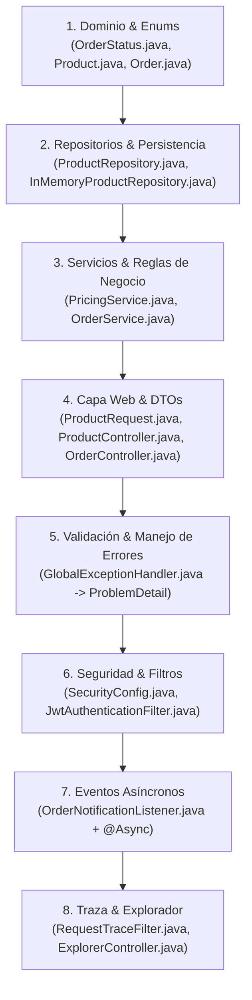

# ☕ Spring Boot Explorer: Pedidos e Inventario
> Aplicación de referencia interactiva de **Java 21 + Spring Boot 3.3** con frontend en **Angular 19**, diseñada para ingenieros de software con experiencia en **TypeScript / Express** y **C# / ASP.NET Core** que quieren dominar Spring Boot y Java moderno sin rodeos teóricos abstractos.

---

## 🚀 Inicio Rápido (Quickstart)

### Requisitos Previos
- **Java 21 LTS**
- **Maven 3.9+** (o el Maven Wrapper incluido `./mvnw`)
- **Node.js 20+** y **npm**
- **Angular CLI** (`npm install -g @angular/cli`)

---

### 1. Ejecutar el Backend (Spring Boot 3.3.5)
En una terminal:
```powershell
# En Windows PowerShell (o bash)
cd backend
mvn spring-boot:run
```
> El backend estará escuchando en `http://localhost:8080`.  
> - **Swagger OpenAPI UI**: [http://localhost:8080/swagger-ui.html](http://localhost:8080/swagger-ui.html)  
> - **Actuator Health**: [http://localhost:8080/actuator/health](http://localhost:8080/actuator/health)  
> - **Actuator Metrics**: [http://localhost:8080/actuator/metrics](http://localhost:8080/actuator/metrics)

---

### 2. Ejecutar el Frontend (Angular 19)
En otra terminal:
```powershell
cd frontend
npm start
```
> El explorador interactivo estará disponible en `http://localhost:4200` (con proxy preconfigurado hacia el puerto 8080).

---

## 🔑 Credenciales de Prueba (Mock Users & JWT)

El sistema incluye autenticación JWT stateless con 3 usuarios mock:

| Usuario | Contraseña | Rol | Cliente Asociado | Permisos |
|---|---|---|---|---|
| `admin` | `admin123` | `ROLE_ADMIN` | N/A (Administrador) | CRUD de productos, envíos, entregas, cancelaciones globales, reset de datos. |
| `user1` | `user123` | `ROLE_USER` | Acme Corp (**PREMIUM** - 5% desc.) | Crear pedidos, confirmar/pagar/cancelar sus propios pedidos. |
| `user2` | `user123` | `ROLE_USER` | Globex Inc (**REGULAR**) | Crear pedidos, confirmar/pagar/cancelar sus propios pedidos. |

---

## 🌉 El Puente Conceptual: Spring Boot ↔ Express ↔ ASP.NET Core

| Concepto Técnico | Spring Boot 3 / Java 21 | TypeScript / Express | C# / ASP.NET Core |
|---|---|---|---|
| **Contenedor DI / IoC** | `ApplicationContext` / `@Component`, `@Service`, `@Repository` | Manual o contenedores (`InversifyJS`, `tsyringe`, `NestJS`) | `IServiceCollection` / `builder.Services.AddScoped<T>()` |
| **Inyección de Dependencias** | Constructor Injection (`final` fields) | Constructor Injection o parámetros en funciones | Constructor Injection estándar en clases |
| **Punto de Entrada HTTP** | `@RestController` + `@RequestMapping` | `express.Router()` (`router.get`, `router.post`) | `[ApiController]` + `[Route]` + `[HttpGet]` |
| **DTOs Inmutables** | Java `record` (Java 16+) | `interface` o `type` (TS) | `record` o `readonly struct` (C# 9+) |
| **Validación Declarativa** | Bean Validation (`@NotNull`, `@Positive`, `@Valid`) | `class-validator` / `zod` / `joi` | Data Annotations (`[Required]`, `[Range]`, `[MinLength]`) |
| **Manejo Global de Errores** | `@RestControllerAdvice` + `ProblemDetail` (RFC 7807) | Middleware `(err, req, res, next)` | `IExceptionHandler` / `ProblemDetails` middleware |
| **Manejo Monetario** | `BigDecimal` (escala y redondeo explícitos) | Librerías (`big.js`, `decimal.js`) — no nativo | `decimal` (nativo de 128 bits) |
| **Máquina de Estados / Enums** | `enum` con métodos y switch expressions (Java 14+) | `enum` simple + funciones helper | `enum` + Extension Methods + switch expressions |
| **Eventos de Dominio** | `ApplicationEventPublisher` + `@EventListener` | `EventEmitter` de Node.js / colas | `MediatR` notifications / `INotificationHandler` |
| **Ejecución Asíncrona** | `@Async` + `ThreadPoolTaskExecutor` (multi-threaded) | Promesas / `process.nextTick` (single-threaded event loop) | `Task.Run` / `BackgroundService` |
| **Seguridad & JWT** | `SecurityFilterChain` + `OncePerRequestFilter` | Middlewares de Express (`passport.js` o custom) | `app.UseAuthentication()` + `JwtBearerHandler` |
| **Perfiles / Ambientes** | `@Profile("jpa")` + `application-{profile}.yml` | `NODE_ENV` + archivos `.env` | `appsettings.Development.json` + `IWebHostEnvironment` |
| **Observabilidad** | Spring Boot Actuator (`/actuator/health`, `/actuator/metrics`) | Custom metrics con `prom-client` | ASP.NET Core Health Checks + `dotnet-counters` |
| **Testing** | JUnit 5 + Mockito + `@WebMvcTest` | Jest / Vitest + Supertest | xUnit / NUnit + Moq + `WebApplicationFactory` |

---

## 🧭 Ruta de Lectura Recomendada

Para estudiar el código fuente de forma sistemática y ordenada, seguí este recorrido guiado:



### Detalle de la Ruta:

1. **Dominio Puro y Máquina de Estados:**
   - [`OrderStatus.java`](file:///c:/repos/javanocio/backend/src/main/java/com/example/explorer/domain/model/OrderStatus.java): Observá cómo un `enum` en Java puede contener comportamiento (`canTransitionTo`), switch expressions y colecciones inmutables (`Set.of`).
   - [`Product.java`](file:///c:/repos/javanocio/backend/src/main/java/com/example/explorer/domain/model/Product.java) y [`Order.java`](file:///c:/repos/javanocio/backend/src/main/java/com/example/explorer/domain/model/Order.java): Entidades ricas con métodos de negocio (`reserveStock`, `restoreStock`, `applyPricing`).
   - [`PricingService.java`](file:///c:/repos/javanocio/backend/src/main/java/com/example/explorer/domain/service/PricingService.java): Uso estricto de `BigDecimal` con `RoundingMode.HALF_UP` y descuentos multiplicativos.

2. **Inyección de Dependencias y Repositorios:**
   - [`ProductRepository.java`](file:///c:/repos/javanocio/backend/src/main/java/com/example/explorer/repository/ProductRepository.java): Interfaz desacoplada del motor de almacenamiento.
   - [`InMemoryProductRepository.java`](file:///c:/repos/javanocio/backend/src/main/java/com/example/explorer/repository/inmemory/InMemoryProductRepository.java): Implementación thread-safe con `ConcurrentHashMap` y `@Profile("!jpa")`.

3. **Capa de Controladores y DTOs con Records:**
   - [`ProductRequest.java`](file:///c:/repos/javanocio/backend/src/main/java/com/example/explorer/web/dto/ProductRequest.java): Java `record` con anotaciones de Bean Validation (`@NotBlank`, `@Positive`, `@Min`).
   - [`ProductController.java`](file:///c:/repos/javanocio/backend/src/main/java/com/example/explorer/web/controller/ProductController.java): Inyección por constructor, paginación y mapeo REST.
   - [`OrderController.java`](file:///c:/repos/javanocio/backend/src/main/java/com/example/explorer/web/controller/OrderController.java): Extracción segura del usuario autenticado desde el `SecurityContextHolder`.

4. **Tratamiento Centralizado de Excepciones:**
   - [`GlobalExceptionHandler.java`](file:///c:/repos/javanocio/backend/src/main/java/com/example/explorer/web/error/GlobalExceptionHandler.java): Uso de `@RestControllerAdvice` y el estándar `ProblemDetail` (RFC 7807) para errores de validación y de negocio (`InsufficientStockException`, `InvalidTransitionException`).

5. **Seguridad y Filtros de Servlet:**
   - [`SecurityConfig.java`](file:///c:/repos/javanocio/backend/src/main/java/com/example/explorer/security/SecurityConfig.java): Configuración funcional de `SecurityFilterChain` en Spring Security 6+.
   - [`JwtAuthenticationFilter.java`](file:///c:/repos/javanocio/backend/src/main/java/com/example/explorer/security/JwtAuthenticationFilter.java): Filtro `OncePerRequestFilter` que valida el token Bearer y puebla el `SecurityContext`.

6. **Eventos y Tareas en Segundo Plano:**
   - [`OrderConfirmedEvent.java`](file:///c:/repos/javanocio/backend/src/main/java/com/example/explorer/domain/event/OrderConfirmedEvent.java): Evento inmutable (record).
   - [`OrderNotificationListener.java`](file:///c:/repos/javanocio/backend/src/main/java/com/example/explorer/event/OrderNotificationListener.java): Listener con `@EventListener` y `@Async`, respaldado por el pool configurado en [`AsyncConfig.java`](file:///c:/repos/javanocio/backend/src/main/java/com/example/explorer/config/AsyncConfig.java).

7. **Trazabilidad del Ciclo de Vida HTTP:**
   - [`RequestTraceFilter.java`](file:///c:/repos/javanocio/backend/src/main/java/com/example/explorer/tracing/RequestTraceFilter.java): Captura los pasos de cada petición en un `ThreadLocal` y devuelve el header `X-Trace-Id`.

8. **Tests Automatizados:**
   - [`OrderServiceTest.java`](file:///c:/repos/javanocio/backend/src/test/java/com/example/explorer/domain/service/OrderServiceTest.java): Pruebas unitarias puras con Mockito.
   - [`ProductControllerTest.java`](file:///c:/repos/javanocio/backend/src/test/java/com/example/explorer/web/controller/ProductControllerTest.java): Pruebas de integración de capa web con `@WebMvcTest` y `MockMvc`.

---

## 🎯 Los 8 Escenarios Guiados en el Explorador

1. **Listar y filtrar productos:** Rutas, query params, paginación manual, records/DTOs y Java Streams.
2. **Crear un producto con datos inválidos:** Bean Validation (`@Valid`), interceptor `@ControllerAdvice` y formato ProblemDetail (RFC 7807).
3. **Confirmar un pedido con stock suficiente:** Inyección por constructor, lógica en servicio, cálculo `BigDecimal`, evento de dominio y listener `@Async`.
4. **Confirmar un pedido sin stock:** Excepciones de negocio tipadas, mapeo a `409 Conflict` y trazabilidad con `X-Trace-Id`.
5. **Seguridad y control de acceso por roles:** `SecurityFilterChain`, filtro JWT, 401 Unauthorized vs 403 Forbidden, y validación de propiedad del pedido.
6. **Cancelar un pedido ya enviado:** Máquina de estados en enum `OrderStatus` con switch expressions y validación de invariantes de negocio.
7. **Migración de Mock a Spring Data JPA:** Comparación lado a lado entre repositorio in-memory y `JpaRepository`, perfiles de Spring (`@Profile`) y anotaciones Hibernate (`@Entity`, `@Table`, `@Id`).
8. **Salud y métricas con Actuator:** Observabilidad lista para producción con endpoints `/actuator/health` y `/actuator/metrics`.

---

## ⚖️ Decisiones Técnicas y Razonamiento

### 1. Maven vs Gradle
- **Elección:** **Maven**.
- **Razón:** En el ecosistema corporativo Java mundial, Maven sigue representando aproximadamente el 65% de los proyectos en producción. Su modelo declarativo (`pom.xml`) y ciclo de vida rígido facilitan el aprendizaje inicial sin lidiar con scripts dinámicos en Groovy/Kotlin DSL de Gradle.

### 2. Java Records vs Lombok
- **Elección:** **Java Records** para DTOs y eventos; clases estándar para entidades de dominio.
- **Razón:** Los records son una característica nativa del lenguaje desde Java 16, inmutables por diseño e ideales para DTOs de request/response. Lombok (`@Data`, `@Getter`, `@Setter`) es muy popular en proyectos legacy, pero modifica el bytecode durante compilación mediante procesadores de anotaciones, ocultando cómo funciona Java internamente.

### 3. Constructor Injection vs Field Injection (`@Autowired`)
- **Elección:** **Inyección por constructor** con atributos `private final`.
- **Razón:** Es la recomendación oficial de Spring y la convención estándar moderna. Hace que las dependencias sean explícitas, previene `NullPointerException`, permite crear objetos en tests unitarios simples sin levantar el contexto de Spring, y es idéntica a la inyección estándar de ASP.NET Core.

---

## 🧪 Ejecutar Tests

Para ejecutar la suite completa de pruebas unitarias y de integración:
```powershell
cd backend
mvn test
```
Resultados esperados: **14/14 tests pasando (0 fallos, 0 errores)**.
